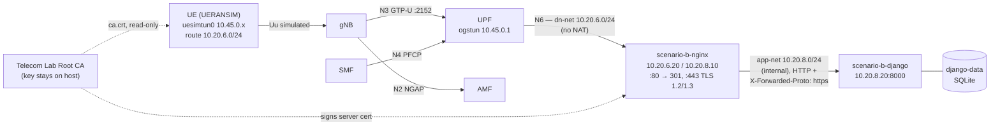

# Project 2 – Telecommunication Security, DevSecOps and Traffic Intelligence
## Technical Report

**Author:** Damien Guffon — Esisar (exchange at RTU Riga)
**Environment:** WSL2 Ubuntu, Docker Engine 29.8.1, Docker Compose 5.5.1, Open5GS 2.7.5 + UERANSIM 3.2.6 (Project 1 network, [Gradiant/openverso-images](https://github.com/Gradiant/openverso-images))
**Status:** Scenario A — Phases 1A, 1B and 1C complete. Phases 1D–1E, Scenario B, the ISCX 2012 evaluation and the LLM cross-validation are not done yet.

Workflow followed: Reuse → Secure → Model → Test → Detect → Automate → Analyze → Defend.

---

## Summary

- **Phase 1A — Reuse and verify.** The Project 1 5G network was reused. A new N6 data network `dn-net` (10.20.6.0/24) was attached to the UPF. A custom UE image installs the persistent route `10.20.6.0/24 dev uesimtun0`. The UE reaches the gateway 10.20.6.20 **through the 5G user plane**, proven by GTP-U packets on N3 that match the ICMP/HTTP packets on N6.
- **Phase 1B — Django.** `telecom-lab-django:0.1` (python:3.12-slim, Django 6.0.8, Gunicorn 26.2.0) runs as `scenario-b-django` at 10.20.8.20:8000. It is attached **only** to the internal `app-net`, with SQLite on the named volume `django-data`, configuration from environment variables, and a Docker healthcheck. `/health/` returns the required JSON through UE → 5G → Nginx → Django. The database survives container recreation.
- **Phase 1C — Secure gateway.** A lab PKI (Telecom Lab Root CA → server certificate with SAN `IP:10.20.6.20`) protects Nginx with TLS 1.2 and 1.3. Older versions are refused. HTTP now answers 301 → HTTPS. The UE validates the certificate with the CA mounted read-only at `/etc/telecom-lab/ca.crt` (`curl --cacert`, never `-k`). Two negative tests show that the validation is real: an unknown CA is refused, and so is a name outside the SAN. Django receives `X-Forwarded-Proto: https`.
- **Design choice:** NAT on the UPF is disabled **towards dn-net only**, so the gateway sees the real UE address (10.45.0.x). That makes per-UE logging and evidence correlation possible.

---

## 1. Architecture



| Network | Subnet | Members | Purpose |
|---|---|---|---|
| `open5gs-and-ueransim_default` | 172.18.0.0/16 (dynamic IPs) | all 5G NFs, gNB, UE | 5G core, N2/N3/N4/SBI (Project 1) |
| `dn-net` | 10.20.6.0/24 | UPF 10.20.6.10 (`n6`), Nginx 10.20.6.20 | N6 data network |
| `app-net` | 10.20.8.0/24, `internal: true` | Nginx 10.20.8.10, Django 10.20.8.20 | internal application network, no external access |
| `security-net` | 10.20.10.0/24 | — | Scenario B (not created yet) |

**Segmentation:** Django is not on dn-net. The only path from the 5G user plane to the application crosses the Nginx gateway. App-net is internal, so Django cannot open connections to the outside either.

---

## 2. Deviations from the reference implementation

The assignment accepts alternative implementations if they meet the same objective with equivalent evidence.

| Reference (guidebook) | This implementation | Why it still meets the objective |
|---|---|---|
| UERANSIM 3.3.0, Open5GS 2.8.0; UE image based on `gradiant/ueransim:3.3.0` | UERANSIM 3.2.6, Open5GS 2.7.5 (Project 1 versions); UE image `telecom-lab-ueransim:3.2.6-p2` based on `gradiant/ueransim:3.2.6` | The guidebook asks to reuse the Project 1 network without rebuilding it. gNB and UE stay on the same release of the simulated radio protocol. The image adds only the persistent route, as required. |
| Separate Docker networks ran-net, n2-net, n3-net, n4-net, sbi-net with fixed IPs | One Docker network for the core (inherited from Project 1, dynamic IPs); only dn-net and app-net (and later security-net) use fixed IPs | The 5G interfaces stay logically distinct (filtered by port: N2 SCTP 38412, N3 UDP 2152, N4 UDP 8805). The security boundary of Scenario A, dn-net ↔ app-net, follows the reference exactly. |
| (Not specified) UPF NAT behaviour on N6 | NAT kept for Internet traffic, disabled for 10.20.6.0/24 (`iptables -t nat -I POSTROUTING -s 10.45.0.0/16 -d 10.20.6.0/24 -j RETURN`); Nginx has the return route `10.45.0.0/16 via 10.20.6.10` | Matches the reference idea of Nginx with iproute2 providing "routing support for the UE PDU path". The real UE IP is visible at the gateway. |
| Nginx reverse proxy introduced in 1C | Plain-HTTP proxy to Django added at 1B | Lets `/health/` be shown end-to-end over 5G at 1B. TLS and the 80→443 redirect come in 1C. |

---

## 3. Phase 1A — Reuse and verify the 5G network

Files: [`p2-compose.sh`](p2-compose.sh), [`compose/p2-core.yaml`](compose/p2-core.yaml), [`images/ueransim-p2/`](images/ueransim-p2/), [`images/nginx/`](images/nginx/). Evidence: [`evidence/phase1A/`](evidence/phase1A/).

**Initial state** ([00-baseline-before.txt](evidence/phase1A/00-baseline-before.txt)): the UE was not registered. MongoDB had stopped cleanly (exit code 0) and `restart: on-failure` does not restart a clean exit. The UDR therefore failed in a loop and the AMF rejected the UE with `PAYLOAD_NOT_FORWARDED`. After a restart of MongoDB and of the UE, the Project 1 baseline was operational again. Fix: `restart: unless-stopped` for MongoDB.

**Changes:**
1. `dn-net` created. The UPF joins it as interface `n6` at 10.20.6.10. `eth0` stays the core network, because `upf.yaml` binds PFCP/GTP-U to `eth0`, and the default route stays on the core (`gw_priority`).
2. NAT exception towards dn-net, inserted before the image's MASQUERADE rule.
3. UE image `telecom-lab-ueransim:3.2.6-p2`: a wrapper entrypoint keeps `10.20.6.0/24 dev uesimtun0` installed. `uesimtun0` exists only once the PDU session is up and can be recreated, so the wrapper uses a loop rather than a single command.
4. Nginx image `telecom-lab-nginx:p2` (nginx + iproute2) at 10.20.6.20, with the return route `10.45.0.0/16 via 10.20.6.10`.

**Evidence:**

```
$ ip route get 10.20.6.20                  (inside the UE)
10.20.6.20 dev uesimtun0 src 10.45.0.2
$ ping -c3 10.20.6.20                       → 3/3, ttl=63 (one hop: the UPF)
$ curl http://10.20.6.20/                   → HTTP 200, local=10.45.0.2
```

No `-I`/`--interface` option was used: the route alone selects the tunnel. The path is proven by simultaneous captures on the UPF ([02-path-proof.txt](evidence/phase1A/02-path-proof.txt), [n3.pcap](evidence/phase1A/p2-1a-n3.pcap), [n6.pcap](evidence/phase1A/p2-1a-n6.pcap)):

| Capture point | What is seen at the same instants |
|---|---|
| N3 (UPF `eth0`, UDP 2152) | 18 GTP-U packets gNB 172.18.0.7 ↔ UPF 172.18.0.9 |
| N6 (UPF `n6`) | `10.45.0.2 > 10.20.6.20: ICMP echo request` / reply — source = real UE IP |
| Nginx access log | `10.45.0.2 - - "GET / HTTP/1.1" 200` |

**Persistence** ([03-persistence-and-state.txt](evidence/phase1A/03-persistence-and-state.txt)): after `docker restart` of the UE, the route was reinstalled automatically and HTTP still returned 200. Internet access through the tunnel, still NATed, was unaffected.

**Checkpoint 1A met:** the UE reaches 10.20.6.20 through `uesimtun0`.

---

## 4. Phase 1B — Django application

Files: [`app/`](app/) (Django project), [`images/django/Dockerfile`](images/django/Dockerfile), [`images/django/requirements.txt`](images/django/requirements.txt), [`images/django/entrypoint.sh`](images/django/entrypoint.sh), [`compose/p2-scenario-a.yaml`](compose/p2-scenario-a.yaml), [`nginx/conf.d/scenario-a.conf`](nginx/conf.d/scenario-a.conf), [`.env.example`](.env.example). Evidence: [`evidence/phase1B/`](evidence/phase1B/).

| Item | Value |
|---|---|
| Image | `telecom-lab-django:0.1` — python:3.12-slim (Python 3.12.15), Django 6.0.8, Gunicorn 26.2.0 |
| Container | `scenario-b-django`, app-net 10.20.8.20:8000 only, runs as non-root `uid=10001(django)` |
| Configuration | `DJANGO_SECRET_KEY` (from `.env`, not committed; startup fails without it), `DJANGO_DEBUG=false`, `DJANGO_ALLOWED_HOSTS`, `DJANGO_DB_PATH` |
| Database | SQLite `/app/data/db.sqlite3` on named volume `django-data` |
| Startup | `manage.py check` → `manage.py migrate` → Gunicorn (2 workers, `X-Forwarded-*` trusted only from Nginx 10.20.8.10) |
| Healthcheck | Docker runs `GET http://127.0.0.1:8000/health/` every 15 s. The view also runs `SELECT 1` on the database, so the container is reported unhealthy (503) if SQLite is unavailable. |

**Required deployment chain**, all satisfied:

| Step | Evidence |
|---|---|
| Image builds | [00-image-and-check.txt](evidence/phase1B/00-image-and-check.txt) |
| `python manage.py check` | `System check identified no issues (0 silenced).` |
| Container becomes healthy | `health=healthy`, healthchecks `exit=0` ([01](evidence/phase1B/01-container-network-volume.txt)) |
| Nginx reaches Django | `curl http://10.20.8.20:8000/health/` from Nginx → `200` ([02](evidence/phase1B/02-health-responses.txt)) |
| `/health/` returns 200 | `{"service": "project2-django", "status": "ok", "project": "Telecommunication Security"}` |

**End to end over 5G:** UE → `uesimtun0` → Nginx 10.20.6.20 → Django returns the same JSON with `HTTP/1.1 200 OK`. Gunicorn logs the request from `10.20.8.10`, which is Nginx.

**Segmentation tests** ([03-isolation.txt](evidence/phase1B/03-isolation.txt)):

| Test | Result |
|---|---|
| UE → 10.20.8.20:8000 directly | timeout (no route into app-net) |
| UPF (dn-net) → 10.20.8.20:8000 | unreachable |
| Django → Internet (1.1.1.1:443) | `Network is unreachable` (app-net is internal) |

**Persistence** ([04-volume-persistence.txt](evidence/phase1B/04-volume-persistence.txt)): the container was removed with `docker rm -f` and recreated, so its container ID changed. The database still holds the same 18 migrations with the same first application time, `2026-10-19 14:29:53`, and the startup log shows `No migrations to apply.`

**Issue found:** Gunicorn 26 opens a control socket under `/app/.gunicorn` by default. That fails for the non-root user, and it is not needed, so it was disabled with `--no-control-socket`, which also removes an unused interface.

---

## 5. Phase 1C — Secure gateway: Nginx and TLS

Files: [`pki/make-pki.sh`](pki/make-pki.sh), [`nginx/conf.d/scenario-a.conf`](nginx/conf.d/scenario-a.conf), [`compose/p2-scenario-a.yaml`](compose/p2-scenario-a.yaml) (Nginx mounts), [`compose/p2-core.yaml`](compose/p2-core.yaml) (CA mount in the UE). Evidence: [`evidence/phase1C/`](evidence/phase1C/).

### 5.1 Lab PKI

`pki/make-pki.sh` writes everything under `secrets/tls/`, which git ignores. It keeps an existing CA and reissues only the server certificate.

| | Root CA | Server certificate |
|---|---|---|
| Subject | `CN=Telecom Lab Root CA, O=Esisar-RTU Telecom Lab, C=LV` | `CN=telecom-lab.local, O=Esisar-RTU Telecom Lab, C=LV` |
| Issuer | itself (self-signed) | `CN=Telecom Lab Root CA` |
| Validity | 2026-10-19 → 2031-10-18 | 2026-10-19 → 2027-11-20 (397 days) |
| Key | RSA 4096 | RSA 2048, signature sha256WithRSA |
| Extensions | `CA:TRUE, pathlen:0`, keyCertSign, cRLSign | `CA:FALSE`, digitalSignature, keyEncipherment, EKU serverAuth |
| SAN | — | `IP:10.20.6.20, DNS:telecom-lab.local, DNS:localhost` |

Source: [00-pki-certificates.txt](evidence/phase1C/00-pki-certificates.txt). The output of `openssl verify` is `OK`.

**Where the keys live:**

| File | Location |
|---|---|
| `ca.key` | host only (mode 600), never mounted in any container |
| `server.crt` + `server.key` | read-only in Nginx (`/etc/nginx/tls/`) |
| `ca.crt` | read-only in the UE (`/etc/telecom-lab/ca.crt`) |

A write attempt inside the UE returns `Read-only file system`. No `*.key` file exists in the UE ([01](evidence/phase1C/01-ue-https-cacert.txt)).

### 5.2 Nginx TLS configuration

| Setting | Value | Reason |
|---|---|---|
| `ssl_protocols` | `TLSv1.2 TLSv1.3` | required versions; TLS 1.0/1.1 are obsolete |
| TLS 1.2 ciphers | ECDHE + AES-GCM / ChaCha20-Poly1305 only | forward secrecy and authenticated encryption |
| `ssl_session_tickets off` | | tickets would weaken forward secrecy |
| `server_tokens off` | | no Nginx version in the `Server:` header |
| `http2 on` | | HTTP/2 over TLS |
| Proxy header | `X-Forwarded-Proto: https` | lets Django know the client used HTTPS after TLS termination |

Following the guidebook order, HTTPS was first enabled and verified **while HTTP still served the application**. HTTP was then switched to `return 301 https://$host$request_uri`.

### 5.3 Evidence (all requests from the UE, through `uesimtun0`)

| Test | Result | Evidence |
|---|---|---|
| `curl --cacert /etc/telecom-lab/ca.crt https://10.20.6.20/health/` | **HTTP 200**, `ssl_verify_result=0`, local 10.45.0.9 | [01](evidence/phase1C/01-ue-https-cacert.txt) |
| Negative: client with public CAs only (`curlimages/curl` in the UE network namespace) | refused: `unable to get local issuer certificate` | [01](evidence/phase1C/01-ue-https-cacert.txt) |
| Negative: name not in SAN (`evil.example` → 10.20.6.20) | refused: `no alternative certificate subject name matches` | [01](evidence/phase1C/01-ue-https-cacert.txt) |
| TLS 1.2 handshake | `TLSv1.2 / ECDHE-RSA-AES256-GCM-SHA384`, verify OK | [02](evidence/phase1C/02-tls-handshakes.txt) |
| TLS 1.3 handshake | `TLSv1.3 / TLS_AES_256_GCM_SHA384`, verify OK (key exchange group `X25519MLKEM768` with an OpenSSL 3.5 client) | [02](evidence/phase1C/02-tls-handshakes.txt) |
| TLS 1.1 / TLS 1.0 | refused by the server: `alert protocol version` | [02](evidence/phase1C/02-tls-handshakes.txt) |
| HTTP → HTTPS | `301 Moved Permanently`, `Location: https://10.20.6.20/health/` → TLS 1.3 → **HTTP/2 200** | [05](evidence/phase1C/05-http-redirect.txt) |
| Header received by Django | Gunicorn log: `xfp=https xff=10.45.0.11` | [04](evidence/phase1C/04-x-forwarded-proto.txt), [05](evidence/phase1C/05-http-redirect.txt) |

The `openssl s_client` handshakes ran in the verification-only `alpine` image. It was started with `--network container:<UE>`, so it shares the UE's interfaces and routes and its traffic also crosses the 5G tunnel.

**HTTPS crosses the 5G user plane, encrypted** ([03-path-capture.txt](evidence/phase1C/03-path-capture.txt), [n3.pcap](evidence/phase1C/p2-1c-n3.pcap), [n6.pcap](evidence/phase1C/p2-1c-n6.pcap)):
- **Packet counts:** 95 GTP-U packets on N3 match 95 TCP/443 packets on N6, all from the UE address 10.45.0.9.
- **Plaintext search:** the Project 1-style HTTP capture of 1A contains the page text (`Welcome to nginx`: 2 matches). The 1C capture contains no trace of the Django JSON (`project2-django`: 0 matches).

**Issue found:** at first Nginx kept serving the old configuration after an edit. It had been mounted as a *single file*, and a bind mount stays attached to the original inode when an editor replaces the file. The whole `nginx/conf.d/` directory is now mounted instead.

---

## 6. Phases 1D–1E — Django security baseline, acceptance test

*Not done yet.*

---

## 7. Scenario B — Security CI/CD and security validation

*Not done yet.*

---

## 8. ISCX IDS 2012 evaluation

*Not done yet.*

---

## 9. LLM-assisted cross-validation

*Not done yet.*

---

## 10. Known limitations (so far)

- **Dynamic UE address.** After a UE restart the SMF can assign a new address (10.45.0.2 → 10.45.0.5 observed). Tests must read the address and not assume it.
- **WSL2 clock steps** (Project 1) can kill the UERANSIM user plane (`uesimtun0` stays UP but carries nothing). This happened again during 1C at 14:49:46 UTC (`Radio link failure detected`, 100 % ping loss), after the TLS evidence had been captured. The fix is to restart the UE, and to stop `systemd-timesyncd` during long runs. This also matters for time-window correlation in Scenario B.
- **Lab PKI:** there is no revocation (CRL/OCSP), and the CA key is an unencrypted file on the host. Acceptable for a lab, not for production.
- The core keeps the single Project 1 Docker network (see §2).

---

## Reproduce

```bash
# Prerequisite: Project 1 core running (ngc.yaml + subscribers), see https://github.com/LeVraiDamien/Projet1Telecom (Project1/ScenarioB)
cd ProjetTelecom2
cp .env.example .env && sed -i "s|change-me|$(python3 -c 'import secrets;print(secrets.token_urlsafe(50))')|" .env
./pki/make-pki.sh                                  # lab CA + Nginx certificate into secrets/tls/
./p2-compose.sh build
./p2-compose.sh up -d --no-deps mongo upf scenario-b-django scenario-b-nginx
docker restart open5gs-and-ueransim-smf-1          # SMF re-resolves the recreated UPF
./p2-compose.sh up -d --no-deps ues1

# Checks
docker exec open5gs-and-ueransim-ues1-1 ip route get 10.20.6.20           # → dev uesimtun0
docker exec open5gs-and-ueransim-ues1-1 curl -s --cacert /etc/telecom-lab/ca.crt https://10.20.6.20/health/   # → {"status": "ok", ...}
docker exec open5gs-and-ueransim-ues1-1 curl -s -o /dev/null -w '%{http_code}\n' http://10.20.6.20/          # → 301
docker inspect -f '{{.State.Health.Status}}' scenario-b-django             # → healthy
```
